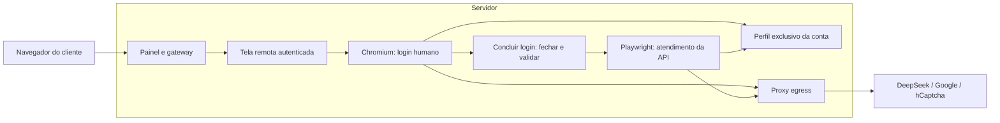

# Histórico do diagnóstico de login — DeepSeek e Qwen

Data de referência: **05/11/2026**. Este documento consolida a investigação,
as alterações, os resultados negativos e os pontos ainda sem confirmação.
Os relatos manuais são identificados como relatos do usuário; testes com
dados fictícios não são apresentados como autenticação real no provedor.

## Estado no encerramento deste registro

1. **O usuário confirmou que concluiu o login no navegador remoto do site.**
   Depois relatou que a conta estava bloqueada pelo DeepSeek e que o painel
   continuava solicitando login, mesmo após usar **Concluir login**.
2. **O bloqueio de rede desse redirecionamento foi identificado e corrigido.**
   O proxy recusava `accounts.google.com.br` com HTTP 403. Após a regra específica,
   o mesmo worker abriu o túnel, validou o certificado TLS e recebeu HTTP 302
   ao consultar a raiz HTTPS desse host, sem cookies de usuário.
3. **A sessão real foi validada e salva, com a restrição do provedor preservada.**
   O worker retornou `state: suspended`, `authenticated: true` e
   `sessionSaved: true`, inclusive após reinício. O aviso informa suspensão
   até `November 6, 2026 04:37`; não foi presumido o fuso horário desse prazo.
4. O fluxo implantado mantém navegador, API e perfil no servidor. O computador
   do cliente apenas acessa o painel e sua tela remota.
5. A última suíte completa no Linux terminou com **110 testes: 109 aprovados,
   um teste externo ignorado e zero falhas**. A alteração posterior de ACL do
   proxy recebeu validação própria de sintaxe e conectividade.
6. A intervenção seguinte corrigiu o caminho da política `BrowserSignin = 0`
   para Chrome for Testing, a prontidão da janela e o encerramento de login
   pendente. Foi validada em contêiner isolado e implantada no worker. O proxy
   agora registra somente metadados de falhas de túnel, com rotação de logs.
   O relato posterior de login concluído e a validação real estão registrados
   na atualização sobre autenticação de conta bloqueada abaixo.

## O que foi feito e o que funcionou

| Área | Alteração ou correção | Evidência e limite do resultado |
| --- | --- | --- |
| Preparação do worker | Limpeza de rede idempotente: desconectar apenas endpoints anexados e tratar o caso específico de recurso ausente ou já desconectado após reinspeção. | Testes de limpeza aprovados. Erros Docker diferentes continuam sendo propagados. Isso trata a falha de infraestrutura `container is not connected to network`; não comprova aprovação do CAPTCHA. |
| Identidade da conta | Uso consistente de `id`, `user_id` e `provider` nas chamadas ao provisioner. Uma chamada de teste confundia o ID da conta Qwen com o dono. | O corpo correto passou pela validação. As verificações de propriedade foram mantidas. Não se concluiu que essa chamada explicasse todos os relatos de `Account ownership mismatch`. |
| Logs | Coleta persistente de console, erros de página e metadados de requests/responses nos contextos controlados pelo Playwright; captura limitada dos indicadores `pass`/`success` do hCaptcha. | Foi possível distinguir respostas HTTP 200 de verificações recusadas com `pass: false`. URLs são sanitizadas; cabeçalhos de autenticação, corpos de requests, respostas dos desafios e tokens não são gravados pelo coletor. |
| Saída de rede | Inclusão dos hosts de hCaptcha, SDKs e outros recursos de autenticação observados como bloqueados, além dos destinos do login GitHub do Qwen. | Os carregamentos antes recusados passaram a responder. Essas correções, isoladamente, não resolveram a recusa do CAPTCHA nos testes antigos. |
| Qwen | Validação de autenticação pela resposta positiva de `auth.qwen.ai/api/v2/auths/`; leitura do catálogo real em `chat.qwen.ai/api/v2/models/`. | A rota de status de visitante não passou a valer como prova de login. Na validação anterior, uma sessão autenticada e um catálogo de sete modelos foram observados, inclusive após reinício. Isso não é uma nova certificação de todos os fluxos do Qwen nesta data. |
| Fechamento da tela | Correção da atualização do painel após o gateway encerrar a conexão VNC de um login confirmado. | Teste de interface cobre a desconexão antes do próximo polling e a exibição de sucesso, sem disparar outro login. |
| Tamanho da tela | Tela remota ocupando o viewport, exibição em tamanho real, rolagem e botão Ajustar à tela. | Testes desktop/mobile e teste com noVNC/RFB reais em um servidor próprio verificaram clique e arraste, ajuste, tela estreita e rolagem. Não foi demonstrado deslocamento que explicasse a recusa do CAPTCHA. |
| Idioma | Configuração `pt-BR` no contexto e no processo de login, com `--lang` e `--accept-lang` no navegador manual. | Idioma JavaScript e cabeçalho de idioma foram verificados em página própria. A tradução de cada página ou widget externo permanece sob controle do provedor. |
| Versões | Playwright/Playwright Core de 1.59.1 para 1.64.1; Chromium do worker de 147.0.7727.15 para Chrome for Testing 156.0.8078.4. | Versões verificadas na imagem e no processo. A atualização não resolveu as seis recusas manuais registradas logo depois. |
| Navegador DeepSeek | Uso do launcher nativo do Playwright no DeepSeek, preservando a integração existente do Qwen. | O caso mínimo também falhou sem carregar os plugins ou módulos da aplicação. Portanto, carregar essas bibliotecas não era condição necessária para reproduzir a falha. |
| Login pelo site | Login humano em um processo de Chromium dentro do worker; botão Concluir login; validação e gravação antes de liberar a API. | O usuário confirmou login completo. A sessão real foi reconhecida e persistida com a conta suspensa, sem liberar geração. Ver a atualização de autenticação de conta bloqueada. |
| Armazenamento entre processos | Mesma configuração de armazenamento no navegador manual e no Playwright, incluindo `--disable-field-trial-config` e o armazenamento de cookies Linux compatível. | O teste reproduziu SQLite em `Default/LocalStorage` no Chromium comum e LevelDB em `Default/Local Storage/leveldb` no Playwright. A configuração comum preservou o armazenamento local na troca. |
| Gravação dos cookies | Auxiliar Linux envia `WM_DELETE_WINDOW` somente às janelas do PID do navegador gerenciado e aguarda sua saída. | O teste mostrou cookie recebido em memória, mas ausente no disco após encerrar por sinal. O fechamento normal gravou o cookie antes de a API abrir o perfil. |
| Reinício e bloqueio do perfil | Marcador `.interactive-login.pending`, gravação atômica do snapshot e espera pela liberação do bloqueio do contexto anterior. | Teste real de processos verifica que um snapshot antigo não sobrescreve a sessão nova durante um reinício, que o marcador é removido após salvar e que o bloqueio do perfil é liberado. |
| Redirecionamento Google regional | Permissão exata para `accounts.google.com.br` no Squid, seguida de validação e recarga por HUP. | Antes: CONNECT 403. Depois: CONNECT 200, TLS válido e HTTPS 302 na raiz. Nenhum navegador ou perfil foi reiniciado para aplicar essa regra. |

Arquivos principais dessas alterações:

- Infraestrutura e isolamento: [network-cleanup.ts](../src/production/network-cleanup.ts),
  [provisioner.ts](../src/production/provisioner.ts) e [workers.ts](../src/production/workers.ts).
- Autenticação e sessão: [deepseek.ts](../src/providers/deepseek.ts),
  [interactive-browser.ts](../src/services/interactive-browser.ts),
  [playwright.ts](../src/services/playwright.ts), [session-store.ts](../src/services/session-store.ts)
  e [close-browser.c](../deploy/close-browser.c).
- Painel: [panel.js](../public/panel.js), [panel.ts](../src/production/panel.ts),
  [gateway.ts](../src/production/gateway.ts) e [index.ts](../src/index.ts).
- Diagnóstico e rede: [browser-logging.ts](../src/services/browser-logging.ts),
  [diagnostics.ts](../src/utils/diagnostics.ts) e [squid.conf](../deploy/squid.conf).
- Imagem do servidor: [Dockerfile de implantação](../deploy/Dockerfile).

## O que não resolveu o problema ou precisou ser corrigido

| Tentativa ou observação | Resultado | Conclusão permitida |
| --- | --- | --- |
| Liberar as primeiras dependências externas bloqueadas | Recursos passaram a carregar, mas continuaram as recusas do CAPTCHA. | Corrigiu carregamentos específicos, sem provar a resolução do desafio. |
| Atualizar Playwright e Chromium | Seis verificações manuais continuaram retornando `pass: false`. | Atualizar a versão, isoladamente, não resolveu. |
| Abrir a aplicação diretamente no Windows, fora de Docker, Squid e noVNC | Quatro verificações retornaram `pass: false`. | Esses três componentes não eram necessários para reproduzir a falha naquele teste. |
| Usar apenas Playwright nativo e o coletor sanitizado, sem módulos da aplicação ou plugins | Quatro verificações retornaram `pass: false`. | Não foi isolada uma biblioteca extra como causa única. |
| Usar o Google Chrome instalado, ainda lançado pelo Playwright | Duas verificações retornaram `pass: false`. | Trocar somente o executável não resolveu. A versão instalada era 156.0.8078.80. |
| Restaurar uma cópia privada do perfil antigo do projeto | O snapshot carregou, mas a página retornou à rota de login. | A sessão antiga não forneceu acesso válido naquele teste; não se determinou se expirou, foi revogada ou deixou de ser aceita por outra razão. |
| Abrir o Chrome comum em perfil novo, sem Playwright | O usuário primeiro confirmou apenas o CAPTCHA; depois informou ter concluído o login completo. | Controle manual bem-sucedido segundo o usuário. A sessão desse teste local não foi importada para o servidor. |
| Primeira troca do navegador manual para a API | O armazenamento local desapareceu da visão da API. A espera adicional no teste não eliminou a divergência. | Foi necessário alinhar a configuração de armazenamento, em vez de tratar a perda como simples demora. |
| Alinhar somente o armazenamento de cookies com `--password-store=basic` | O teste de cookie ainda falhou. | A configuração compatível foi mantida, mas não foi suficiente para corrigir a gravação no encerramento. |
| Encerrar o navegador manual por `SIGTERM` | No teste, o processo saiu com código zero, mas o cookie recém-recebido não constava no banco. | Saída normal do processo não comprovou persistência. O fluxo foi alterado para fechar a janela normalmente. |
| Primeiras execuções de testes no Windows | Houve timeout de inicialização e, no novo teste de interface, faltava simular uma rota de cancelamento do Qwen. | Foram corrigidos o orçamento do teste de login e a simulação da rota. A lentidão exata do Windows não foi isolada como causa; isso não explica o CAPTCHA. A verificação final foi feita também no Linux. |
| `EvalError` no console de `hsw.js` | Observado durante tentativas, sem relação causal demonstrada com a recusa. | Permaneceu uma observação, não uma causa confirmada nem uma justificativa para desativar proteções do widget. |
| Avanço do login remoto seguido de erro Google | O usuário avançou pelo CAPTCHA e chegou a `/accounts/SetSID` em `accounts.google.com.br`, que estava bloqueado. | Foi identificado outro problema, de rede, depois do avanço do CAPTCHA. A correção dessa etapa ainda exige retomar o fluxo real. |

Os resultados negativos vieram de tentativas distintas. Eles não demonstram
que todas as falhas tiveram a mesma causa, nem que uma correção específica
explique retroativamente todos os relatos.

## Comparação com o código de dois dias antes

A consulta ao Git usou estas referências, com horários locais `-03:00`:

| Referência | Comportamento identificado |
| --- | --- |
| `b76bb022a7aaae7575f4f739d95df2586fae864f`, 03/11 às 19:37 | Estabilização de sessão e pausas; login e API compartilhavam contexto e janela. |
| `0d5942e50fe206a6e61a6d47519a0784d4212285`, 03/11 às 21:53 | `npm run login` executava `src/login.ts`, aguardava o chat visível, salvava a sessão e mantinha o navegador aberto. Playwright 1.59.1, sem os plugins posteriores. |
| `38da478`, 04/11 | Instrumentação e guardas de sessão/geração. |
| `9841eea`, 04/11 às 21:43 | Remoção da janela externa de login e adoção do painel e dos perfis por conta. |
| `93137aa`, 04/11 às 22:57 | Introdução de `playwright-extra`/stealth e mudanças na criação da aba e no User-Agent. |

A referência antiga também continha User-Agent fixo e flags personalizadas.
Sua eficácia para o problema atual não foi comprovada. Não houve rollback
integral nem teste que demonstrasse que reaplicar uma dessas flags resolveria
o CAPTCHA. A cópia do snapshot original foi testada separadamente; seu hash
na origem permaneceu igual durante esse ensaio.

## Fluxo atual e separação entre cliente e servidor

O CAPTCHA, a senha e os demais passos interativos são realizados pelo usuário
na tela remota. O perfil pertence ao worker da conta e fica no volume do
servidor em `/profile`. A sessão do Chrome do cliente não é necessária.

Ao clicar em **Concluir login**, o worker solicita o fechamento normal da
janela, espera o processo sair e abre o mesmo perfil na API. O estado anterior
não deve sobrescrever esse perfil. Somente após validar o chat e gravar a
sessão a fila é liberada e o painel pode encerrar a tela remota.

O Qwen mantém sua confirmação automática existente. O processo independente
`npm start` utiliza seu próprio perfil e não compartilha automaticamente
a sessão dos workers do painel. Para implantar em outro servidor, seguir o
[guia de produção](../deploy/README.md); `localhost:3440` identifica o laboratório local.

## Evidências e verificações

### Comparações do CAPTCHA

Os horários dos logs desta tabela estão em **UTC**, em 05/11/2026.

| Cenário | Evidência local |
| --- | --- |
| Worker atualizado: seis recusas entre 14:44 e 14:48 | `.cache/deepseek-captcha-diagnostic.md` |
| Aplicação fora do painel: quatro recusas entre 16:28 e 16:30 | `.cache/login-direct/20261105_131433/project-result.json` |
| Playwright mínimo: quatro recusas, incluindo 16:44, 16:45 e 17:23 | `.cache/login-direct/20261105_131433/minimal-result.json` |
| Chrome instalado sob Playwright: duas recusas às 17:34 | `.cache/login-direct/chrome-stable_20261105_142606/minimal-result.json` |
| Cópia do perfil antigo: retorno ao login às 17:44 | `.cache/login-direct/original-session_20261105_144314/project-session.log` |

Nessas recusas, HTTP 200 significou recebimento da resposta, não aprovação.
O coletor registrou `pass: false`, sem códigos específicos que explicassem a
decisão. O motivo exato da classificação de cada tentativa pelo provedor não
foi demonstrado.

### Validação da implementação atual

| Verificação | Resultado | Registro |
| --- | --- | --- |
| Suíte completa Linux | 110 testes; 109 aprovados; um externo ignorado; zero falhas | `.cache/server-login-all-final.log` |
| Regressão do login humano, cookie, snapshot antigo e reinício | Aprovada com processos reais e página própria | [interactive-browser.test.ts](../src/interactive-browser.test.ts) |
| Confirmação pelo dono da conexão, falha antecipada e polling durante a troca | Aprovados | [production.test.ts](../src/production.test.ts) |
| Interface, alternância entre provedores, confirmação recusada e sucesso | Aprovados | [production-ui.test.ts](../src/production-ui.test.ts) |
| noVNC/RFB: clique, arraste, escala e rolagem | Aprovados em serviço de teste próprio | [remote-viewer.test.ts](../src/remote-viewer.test.ts) |
| Imagem do worker com sandbox, proxy, filesystem somente leitura e rede externa desabilitada | Ciclo manual disponível, confirmação antecipada recusada, pt-BR e sessão fictícia preservada na troca e no reinício | `.cache/server-login-smoke-ready.log` |
| Build TypeScript e verificação de whitespace do diff | Aprovados | `npm run build` e `git diff --check` |
| Ambiente implantado | Gateway e assets responderam HTTP 200; worker Linux saudável; auxiliar de fechamento disponível | Verificação operacional da sessão de trabalho |

Os testes de sessão usam páginas e dados fictícios. Nenhum desafio real foi
resolvido automaticamente, e esses testes não enviaram mensagens ao DeepSeek.
O sucesso real do usuário no CAPTCHA é uma evidência separada dos testes.

### Redirecionamento Google regional

Foi acrescentado apenas o host observado `accounts.google.com.br`.
Permitir `.google.com` não inclui esse domínio regional. A configuração
passou por `squid -k parse` e foi recarregada por HUP, sem reiniciar a sessão.

| Destino do teste CONNECT | Antes | Depois |
| --- | --- | --- |
| `accounts.google.com.br:443` | 403 | 200; certificado TLS validado; raiz HTTPS respondeu 302 |
| `accounts.google.com:443` | 200 | 200 |
| `example.com:443` | 403 | 403 |
| `127.0.0.1:443` | 403 | 403 |
| `169.254.169.254:80` | 403 | 403 |
| `accounts.google.com.br:8443` | Não usado no teste inicial | 403 |

Não foi reproduzida a URL de autenticação com seus parâmetros. O teste de
HTTPS usou apenas a raiz do host, sem cookies. Portanto, ele comprova
conectividade e validação TLS, não a conclusão do OAuth.

## Registros, preservação e limites de observação

- Este documento fica fora de `.cache` para permanecer visível no projeto
  e poder ser versionado. Os arquivos `.cache` são evidências locais ignoradas
  pelo Git e podem não existir em outra instalação.
- Os relatórios anteriores são registros de etapas da investigação. Frases
  como “comparação pendente” ou “CAPTCHA ainda não avançou” nesses arquivos
  descrevem seus respectivos momentos, não substituem o estado consolidado aqui.
- O coletor detalhado de console e requests atua nos contextos conectados ao
  Playwright. Na etapa manual, há registros do ciclo do processo. Inicialmente
  o Squid usava `access_log none`; na intervenção descrita abaixo passou a
  registrar falhas de CONNECT com domínio, porta e status. Isso não é um
  histórico completo das requisições dentro de HTTPS e não captura seus corpos.
- O perfil pessoal do Chrome não foi importado. A cópia do perfil antigo do
  projeto foi isolada. Os volumes do servidor foram mantidos e o perfil DeepSeek
  recebeu backup antes da implantação. O nome do backup do ensaio está em
  `.cache/server-login-backup-volume.txt`.
- O perfil recebeu outro backup antes de ativar a política de login do navegador.
  Seu nome está em `.cache/browser-signin-policy-backup-volume.txt`.
- As imagens anteriores do laboratório foram mantidas nas tags
  `deepsproxy-worker:before-server-login-20261105` e
  `deepsproxy-runtime:before-server-login-20261105`. Recuperação de dados e
  atualização de instalações estão descritas no [guia de produção](../deploy/README.md).
- Não incluir neste histórico senhas, chaves, cookies, conteúdo dos snapshots,
  parâmetros de OAuth, respostas dos desafios ou a URL completa da captura de erro.
  Nenhum relatório desta investigação foi enviado a terceiros.

## O que falta para considerar o fluxo real concluído

1. Retomar a página bloqueada dentro do navegador remoto, após a recarga da ACL.
2. Confirmar que o Google retorna ao chat real do DeepSeek.
3. Clicar em **Concluir login** e verificar `authenticated` com sessão salva
   tanto no worker quanto no painel.
4. Confirmar a preservação dessa sessão real após reiniciar o worker, em momento
   combinado para o teste. A persistência com dados fictícios já foi verificada.
5. Se houver outra falha, registrar a etapa e a evidência específica. Não declarar
   sucesso completo só porque o CAPTCHA avançou, um request retornou 200 ou a
   suíte automática passou.

## Atualização: autenticação de conta bloqueada

O usuário confirmou que concluiu o login pelo site, mas o DeepSeek mostrou
uma restrição da conta. O botão **Concluir login** não reconhecia esse caso:
a transferência para a API aguardava um editor disponível, a gravação da
sessão recusava uma conta suspensa e o gateway só aceitava o estado
`authenticated` para encerrar o login. O painel, portanto, confundia a
restrição de uso com a necessidade de autenticar novamente.

Correções aplicadas:

- A confirmação explícita aceita um aviso de suspensão na página de chat
  do DeepSeek, salva a sessão e mantém `state: suspended` junto de
  `authenticated: true`. Um aviso na rota de login não comprova autenticação.
- O bloqueio persistente de geração continua ativo. Salvar uma sessão
  restrita não limpa esse bloqueio nem autoriza envios.
- O gateway aceita essa confirmação apenas com autenticação reconhecida e
  sessão salva, preservando as verificações de posse da conexão.
- O banco guarda separadamente o reconhecimento de autenticação e o aviso
  do provedor. Eles sobrevivem à espera do navegador e ao reinício do painel.
- O card mostra **Autenticada · conta bloqueada**, **Sessão salva**, o aviso
  original e o prazo informado. O aviso é renderizado como texto. Os modelos
  da conta bloqueada não aparecem como disponíveis para uso.

Validação desta alteração:

- Compilação TypeScript aprovada. **30 testes aprovados** nas duas execuções
  finais de regressão: `.cache/restricted-login-regression.log` e
  `.cache/restricted-login-additional.log`. Incluem confirmação de conta
  bloqueada, rejeição de confirmação sem sessão salva, persistência no banco,
  migração repetida, isolamento, aviso seguro e interface móvel.
- A imagem final passou no teste isolado de navegador humano, transferência
  de perfil, política de login do Chrome e reinício:
  `.cache/restricted-login-image-smoke.log`. Usa perfil e páginas fictícios,
  sem rede externa. A primeira execução desse teste não tinha o diretório
  temporário `/home/node` usado em produção e falhou na inicialização; a
  configuração corrigida passou.
- Na conta real, a validação explícita retornou HTTP 200 e o estado
  `suspended`, `authenticated: true`, `sessionSaved: true`, com prazo
  `November 6, 2026 04:37`. O mesmo estado foi confirmado após reiniciar o
  worker. O banco utilizado pelo painel também contém esses dados.
- A verificação local da proteção de geração retornou o bloqueio HTTP 403.
  Nenhuma mensagem de teste foi enviada ao DeepSeek nesta validação.

Antes da troca, a janela foi fechada normalmente e o perfil foi copiado para
`dsp_live_backup_cb4b2fe2_restrictedlogin_20261105_184511`, com origem somente
para leitura e comparação completa dos arquivos. Uma primeira cópia não
preservou permissões por falta da capacidade `FOWNER`; foi repetida e
verificada antes de iniciar o worker. O nome está também em
`.cache/restricted-login-backup-volume.txt`.

As imagens anteriores foram preservadas com a tag
`before-restricted-login-20261105` nos repositórios locais do runtime e do
worker. Não houve cópia do perfil do navegador pessoal do Windows. A
restrição imposta pelo provedor permanece; a correção registra e apresenta
esse estado sem exigir outro login.

## Atualização anterior: aviso de conexão e ajuda do próprio Chrome

Após a correção de `accounts.google.com.br`, o usuário mostrou um aviso nativo
`Can't sign in` com `Connection failed (-111)` sobre a página de consentimento
do Google para o DeepSeek. A tela seguinte era a ajuda do Chrome, artigo 165139,
sobre entrar no perfil do navegador e acessar dados da conta em dispositivos.
Ela não constitui confirmação do login no DeepSeek.

O código `-111` corresponde a `TUNNEL_CONNECTION_FAILED` na lista oficial do
Chromium. Ele identifica uma falha de túnel pelo proxy; não informa sozinho
qual destino foi recusado nem comprova uma nova falha de CAPTCHA.

### Descobertas e alterações desta intervenção

| Item | Evidência ou resultado |
| --- | --- |
| Diretório de políticas incorreto para o binário em uso | O worker tinha políticas em `/etc/chromium/policies/managed` e `/etc/opt/chrome/policies/managed`, mas não em `/etc/opt/chrome_for_testing/policies/managed`, que a documentação oficial indica para Chrome for Testing. |
| Política restrita de perfil | Criado [browser-signin-policy.json](../deploy/browser-signin-policy.json), com `BrowserSignin: 0`, copiado ao diretório correto. A política desativa o login no perfil do Chrome; a documentação oficial permite continuar usando os serviços Google pela web. |
| Verificação da aplicação real da política | Em perfil fictício, `chrome://policy` mostrou `BrowserSignin` e valor `0`. O mesmo teste preservou cookie e armazenamento na troca para a API e no reinício. Log: `.cache/browser-signin-ready-smoke.log`. |
| Janela anunciada pronta antes de existir | O teste expôs uma corrida no atraso fixo de 750 ms: o auxiliar podia não encontrar uma janela ao encerrar. O serviço passou a aguardar uma janela do PID gerenciado, usando o modo `--check` do auxiliar, com espera limitada. |
| Encerramento durante login pendente | `confirmLogin` passou a retornar rejeição assíncrona de forma consistente, e o shutdown usa `try/catch` para que uma confirmação recusada não pule o fechamento normal. O teste verifica o contrato da rejeição; na atualização operacional a janela antiga foi fechada normalmente antes da parada do worker. |
| Observabilidade da falha de túnel | Acrescentado log exclusivo para CONNECTs com falha: domínio, porta, status HTTP e resultado Squid. Não registra caminho, query, cookies, cabeçalhos ou conteúdo TLS. O Docker limita o log a dois arquivos de 10 MB. |
| Implantação | O worker antigo foi encerrado após fechamento normal da janela, o perfil recebeu novo backup e o worker atualizado ficou saudável. A presença de `BrowserSignin: 0` foi verificada no diretório correto da imagem em execução. O login real continua pendente. |

Arquivos adicionais envolvidos: [close-browser.c](../deploy/close-browser.c),
[interactive-browser.ts](../src/services/interactive-browser.ts),
[deepseek.ts](../src/providers/deepseek.ts), [index.ts](../src/index.ts),
[egress.Dockerfile](../deploy/egress.Dockerfile),
[squid.conf](../deploy/squid.conf) e [compose.production.yml](../compose.production.yml).

### Tentativas que não funcionaram nesta intervenção

- Copiar todo o arquivo de políticas antigo para o diretório do Chrome for
  Testing causou timeout de 180 segundos no lançamento pelo Playwright no
  contêiner de teste. Essa variante não foi aplicada à sessão real. Foi usada
  uma política restrita ao login do perfil, compatível com o canal da API.
- A primeira imagem com a política restrita ainda expôs a corrida da janela
  não criada. A espera pela janela real foi necessária para passar pelo ciclo.
- A sintaxe inicial do log sem unidade em `buffer-size=0` foi recusada pelo
  parser; foi corrigida para `0KB` antes da recarga, mantendo a configuração
  anterior em execução durante a falha da validação.
- Abrir diretamente `/dev/stdout` no primeiro teste de logging deu permissão
  negada após o Squid reduzir seus privilégios. A imagem passou a preparar os
  streams de log para seu usuário `proxy` antes de iniciar o serviço. O teste
  seguinte registrou o CONNECT recusado corretamente, mantendo HTTP 403 para
  destinos privados.

### Limite do diagnóstico do `-111`

O diagnóstico temporário observou recusas para serviços de atualização,
preenchimento automático, Safe Browsing e um recurso do login Apple. Não foi
demonstrado que esses hosts explicassem o aviso no login Google, e eles não
foram liberados por suposição. O host da conexão de autenticação que originou
aquele aviso ainda não foi estabelecido.

A política ausente era um problema de configuração verificável e foi corrigida.
Sua relação causal exclusiva com o `-111` ainda exige a nova tentativa real.
As verificações posteriores à última suíte completa foram build/diff, teste
isolado da nova imagem e testes de logging/conectividade; a suíte completa
anterior não deve ser apresentada como validação do login real desta versão.

## Referências consultadas

- [Playwright: autenticação e reutilização de estado](https://playwright.dev/docs/auth).
- [Playwright: navegadores e atualização](https://playwright.dev/docs/browsers).
- [hCaptcha: perguntas frequentes e suporte de navegadores](https://docs.hcaptcha.com/faq).
- [hCaptcha: envio de relatos de problemas](https://www.hcaptcha.com/reporting-bugs).
- [Chromium: caminhos de armazenamento local em SQLite e LevelDB](https://chromium.googlesource.com/chromium/src/+/d3e4a65547cbf0ab432b18ef96c38474a3bdd94f).
- [Squid: ACLs](https://www.squid-cache.org/Doc/config/acl/).
- [Relato consultado no repositório DeepSeek, issue 1700](https://github.com/deepseek-ai/DeepSeek-V3/issues/1700).
  Esse relato de terceiros não foi tratado como diagnóstico confirmado deste projeto.
- [Chromium: diretórios de políticas por distribuição](https://chromium.googlesource.com/chromium/src/+/HEAD/docs/enterprise/policies.md).
- [Chromium: política BrowserSignin e sua aplicação no próximo início](https://chromium.googlesource.com/chromium/src/+/HEAD/components/policy/resources/templates/policy_definitions/Miscellaneous/BrowserSignin.yaml).
- [Chromium: código de rede -111](https://github.com/chromium/chromium/blob/main/net/base/net_error_list.h).
- [Google: ajuda de login no perfil do Chrome, artigo 165139](https://support.google.com/chrome/answer/165139?hl=pt-BR).
